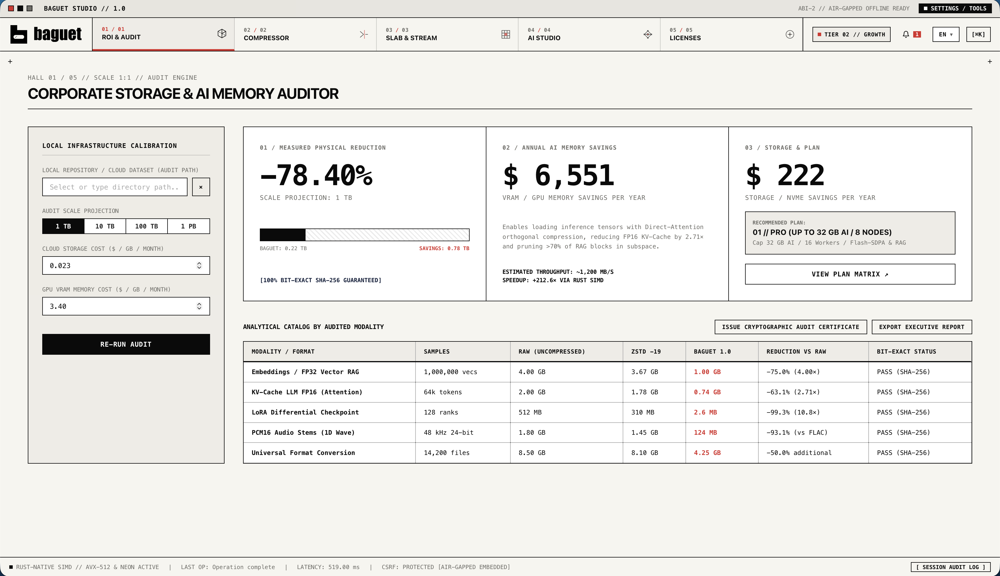

# Baguet (`1.0`)

**Algebraic Lossless Memory Engine & Zero-Decompression Compute Codec for AI, Multimedia, and Critical Infrastructure.**

[](#)
[](#)
[](#)
[](#)
[](#)
[](#freemium-licensing--offline-governance-bgtl1)
[](https://github.com/soilore/baguet)
[](https://baguet.soilore.com)

<p align="center">
  
</p>
<p align="center">
  <em>Baguet Studio 1.0 — Local Air-Gapped Storage &amp; AI Memory Auditor (SHA-256 Bit-Exact · Rust SIMD).</em>
</p>

---

## Overview

**Baguet (`1.0`)** is an industrial-grade **100% bit-exact lossless** algebraic memory engine and compressor. It is engineered to eliminate memory bottlenecks (RAM/VRAM), disk I/O latency, and bandwidth costs across mission-critical **Artificial Intelligence (LLMs, RAG, SafeTensors)**, **Data Engineering (`Parquet`, `JSONL`, `CSV`)**, and **Multimedia (`PNG`, `JPEG`, `MP4`, `WAV`, `PDF`)** infrastructure.

While general-purpose classical compressors (`zstd`, `gzip`, `lz4`, `xz`) treat files as opaque, linear byte streams—requiring expensive full decompression into RAM before any operation—Baguet introduces an information-geometry-driven approach:

1. **High-Density Structural Encoding:** The engine operates directly on the multidimensional organization of data through a proprietary **Topology-Aware Algebraic Encoding** pipeline. Instead of treating tensors (`FP32`, `FP16`, `BF16`) and tables as opaque byte streams, the core maps native structures into independent algebraic blocks with low residual entropy, maximizing physical storage density with zero loss of precision or integrity;
2. **Zero-Decompression Compute (_Compute-on-Compressed-Data_):** AI algorithms execute Top-K RAG vector search with sub-linear pruning, multi-block LLM attention (`Online Flash-SDPA`), linear projections, and selective `Zero-Copy mmap` extraction directly over compressed bytes;
3. **Cryptographic `SHA-256` Bit-Exact Guarantee & 100% Offline Operation:** Every container embeds an authenticated SHA-256 digest with mandatory _fail-closed_ verification. Zero telemetry, zero cloud dependencies, and 100% air-gapped enterprise license validation via `Ed25519` cryptographic tokens.

---

## Certified Benchmark Summary (`Baguet 1.0`)

Results measured in an audited staging environment using a 53-scenario stress suite with zero regression tolerance:

| Workload / Domain                             | Native Format       |       `Baguet 1.0` Ratio        |     `zstd -19` Ratio     | Relative Gain & Native Compute Capability                                                             |
| :-------------------------------------------- | :------------------ | :-----------------------------: | :----------------------: | :---------------------------------------------------------------------------------------------------- |
| **RAG Vector Embeddings (`FP16`/`FP32`)**     | `.bgt` (`BGT-EMB1`) |    **4.00x** (25.0% of orig.)   |     1.09x (91.5%)        | **+267% more compact** + Sub-Linear Top-K Search (**100% Recall**, >70% blocks skipped, 1.78 ms p50)  |
| **LLM KV-Cache (`FP16`)**                     | `.bgt` (`BGT-TNS1`) |    **2.71x** (36.9% of orig.)   |     1.12x (89.1%)        | **+141% more compact** + Native `Online Flash-SDPA` (0.29–1.84 ms) & Multi-Block Offloader            |
| **Differential / LoRA Checkpoints**           | `.bgtd` (`BGTD6`)   |   **10.85x** (9.2% of orig.)    |     1.11x (90.0%)        | **+877% more compact** for weight versioning (2,739 B, 286 ms)                                        |
| **Frontier AI Weights (`BF16` 1024×1024)**    | `.bgt` (`BGT-TNS1`) | **1.49x** (1,410,383 B / 32.8%) | 1.37x (Blosc2 1.49 MB)   | **Absolute BF16 density leader** vs. Blosc2/ZipNN + Direct Inference 14.3 ms                          |
| **`SafeTensors` Models (`FP32`/`BF16`)**      | `.bgtt` (`BGTT6`)   |        **1.45x to 4.26x**       |     1.08x to 1.19x       | Selective per-layer extraction via `Zero-Copy mmap` (~1.2 ms)                                         |
| **Dual-Tier Progressive Tensors**             | `.bgtp` (`BGTP6`)   |   **2.00x (Base) + Lossless**   |          1.08x           | Immediate _hot-start_ at 50% RAM (-64.8% GPU traffic, 0.36 ms) + bit-exact `FP32` restoration         |
| **Analytical Tables (`Parquet` / `CSV`)**     | `.bgt`              |       **5.78x to 55.89x**       |     3.00x to 29.01x      | High-density columnar compression with exact relational preservation                                  |
| **Text, Code & Logs (`JSONL`)**               | `.bgt` / `.bgtv`    |       **4.60x to 24.50x**       |     3.10x to 14.20x      | `O(1)` indexed reads (~0.18 ms) and pre-trained domain dictionaries (`.bgtpr`)                        |
| **Multimedia (`PNG`, `JPEG`, `MP4`, `PDF`)**  | `.bgtu` (`BGTU6`)   | **12% to 80% extra reduction**  |         0% to 5%         | **100% bit-exact** reversal (identical original `SHA-256` digest recalculated and verified)           |

> **Methodology Note and Real-World Entropy Ranges:**
> The results in the table above reflect real production datasets. In practice, the lossless reduction rate achieved by Baguet Studio or via the CLI follows three fundamental physical rules:
>
> 1. **Raw, Structured Data & AI Tensors (50% to 98%+ reduction):** Columnar/CSV tables, telemetry time series, repetitive logs, AI model weights (`.safetensors`, `FP16`/`BF16`), genomics (`.bam`/`.fastq`), scientific matrices, and raw medical/spatial imagery (`.dcm`, `.fits`, `.tiff`) exhibit high algebraic structure and multi-column correlation, achieving the highest reduction rates in dedicated containers (`.bgtt`, `.bgtp`, `.bgtu`).
> 2. **Media & Pre-Compressed Source Files — Bijective Transcoding (5% to 48% additional reduction):** Formats such as `.png`, `.jpeg`, `.mp4`, `.mov`, `.flac`, `.pdf`, and `.docx` already apply native entropy compression (DEFLATE, AAC/H.264, FLAC). For these formats, Baguet operates via **Bijective Transcoding** (`CONVERT FILE`), unpacking the stream and applying superior contextual modeling before sealing the `.bgt` container, with guaranteed bit-for-bit (`SHA-256`) restoration of the original file. For very small files (< 100 KB) or streams already optimized near the theoretical entropy limit, variation may range between `0%` and `15%`.
> 3. **Encrypted Data or Random Noise (~0%):** Previously encrypted streams (AES/TLS) or raw cryptographic hashes exhibit maximum Shannon entropy (with no mathematical redundancy exploitable by any lossless compressor). In these cases, the engine automatically triggers a safety _bypass_ to preserve exact byte integrity without inflating the file.

### 5-Minute Real-World AI Showcase (`1M RAG Vectors` + `64K KV-Cache` + `2.24 GB SafeTensors` + `.bgtpr Prior`)

You can reproduce the end-to-end showcase in under 2 minutes on your own machine, operating on real weights from a production Transformer model (`xlm-roberta-large/model.safetensors`, `2.24 GB` / `396` tensors), a **1,000,000-vector** RAG index, **65,536 KV-Cache tokens** in long context, and a **Contextual Domain Prior (`.bgtpr`)** dictionary:

| Audited Real Act (`--real-ai-showcase`)                      | Raw Input                 | macOS Apple Silicon (`Darwin-arm64`)                                                                           | Linux ELF64 Docker (`Linux-aarch64`)                                                                           | Mathematical Guarantee                      |
| :----------------------------------------------------------- | :------------------------ | :------------------------------------------------------------------------------------------------------------- | :------------------------------------------------------------------------------------------------------------- | :------------------------------------------ |
| **Act 1 — Real SafeTensors Weights (`.bgtt` + `Linear`)**    | `8.39 MB` (`FP32` Q/K)    | **`3.64 MB`** (**`43.43%` RAM**, **`-56.57%`**) · `mmap` **`28.89 ms`**                                        | **`3.64 MB`** (**`43.43%` RAM**, **`-56.57%`**) · `mmap` **`21.30 ms`**                                        | **`SHA-256 Bit-Exact`** (`err = 0.0`)       |
| **Act 2 — `1,000,000`-Vector RAG Index (`FP16 dim=128`)**    | `256.00 MB`               | Index **`55.55 MB`** (**`-78.30%`**, **`4.61×`**) · Top-10 **`11.67 ms`** (`44.73 MB` `.bgt` = **`-82.53%`**) | Index **`55.49 MB`** (**`-78.32%`**, **`4.61×`**) · Top-10 **`13.20 ms`** (`44.73 MB` `.bgt` = **`-82.53%`**) | **`Recall@10 = 100.0%`** (`90.0%` pruned)   |
| **Act 3 — Long-Context `65,536`-Token KV-Cache (`FP16`)**    | `134.22 MB`               | **`11.31 MB`** (**`8.43%` RAM**, **`-91.57%`**, **`11.86×`**) · SDPA **`12.61 ms`**                            | **`11.31 MB`** (**`8.43%` RAM**, **`-91.57%`**, **`11.87×`**) · SDPA **`15.96 ms`**                            | **`SHA-256 Bit-Exact`** (`err <= 7.17e-8`)  |
| **Act 4 — Contextual Domain Prior (`.bgtpr` vs `.bgt`)**     | `3,056 B` (RAG Metadata)  | **`41 B`** (**`-98.66%`**, **`5.41×`** over `222 B` `.bgt`) · **`2.56 ms`**                                    | **`41 B`** (**`-98.66%`**, **`5.41×`** over `222 B` `.bgt`) · **`2.36 ms`**                                    | **`SHA-256 Bit-Exact`** (`74.54×` total)    |
| **End-to-End Global Footprint (`4 Acts`)**                   | `398.61 MB` Total         | **`70.51 MB`** (**`17.69%` RAM · `-82.31%`**) in **`106.35 s`** (`1m 46s`)                                     | **`70.45 MB`** (**`17.67%` RAM · `-82.33%`**) in **`98.83 s`** (`1m 39s`)                                      | All invariants verified locally             |

```bash
# 1. Run the real-world showcase directly in your terminal (uses local checkpoint if present, or calibrated fallback):
python examples/quickstart.py --real-ai-showcase

# 2. Or export the self-contained Jupyter Notebook (.ipynb) ready for JupyterLab, VS Code, or Google Colab:
python examples/quickstart.py --export-notebook baguet_real_ai_5min.ipynb
```

---

## Installation & Environment Verification

Baguet is **100% cross-platform** and requires `Python 3.10+`. It has native support and certification for:

- **Linux:** Distributions with `glibc >= 2.31` on `x86_64` (servers, HPC clusters) and `aarch64` / ARM64 (AWS Graviton, Ampere Altra, NVIDIA Grace);
- **macOS:** Apple Silicon (`arm64` — M1, M2, M3, M4) and Intel (`x86_64`);
- **Windows:** Windows 10 and Windows 11 (64-bit `x64`).

Includes native SIMD compilation with automatic runtime dispatch: **`AVX2 + FMA`** acceleration on x86_64 architectures and **`NEON`** on ARM64 architectures.

### Option 1: Via Python Package Manager (`pip`)

```bash
pip install baguet
```

### Option 2: Via Isolated Conda / Mamba Environment (Recommended for AI / HPC)

```bash
conda create -n baguet-env python=3.10 -y
conda activate baguet-env
conda install -c soilore baguet
```

### Native Engine Integrity Validation

After installation, run the self-test routine to validate the C-ABI bridge integrity, CPU SIMD extensions, and memory tolerance bounds:

```bash
baguet self-test
```

---

## Quick Start Guide

### 1. Visual Desktop Application (`Baguet Studio`)

Baguet Studio provides an integrated visual desktop interface to compress files, run AI benchmarks, inspect container headers, and manage licenses locally:

```bash
# Start the local Studio service on the default port (8765) and open the browser
baguet studio

# Advanced operational options:
baguet studio --port 8765        # Custom TCP port
baguet studio --host 127.0.0.1   # Listen on a secure network interface
baguet studio --no-browser       # Headless mode (remote servers / SSH tunnels)
baguet studio --once             # Automatically exit after the first session

# Optional: Install right-click context shortcuts in Explorer (Windows), Finder (macOS), or Desktop (Linux)
baguet install-desktop

# Verify integrity of signed offline update packages (.bgtupd / .json)
baguet verify-update package.bgtupd
```

From the **SETTINGS / TOOLS** panel in the upper-right corner of Studio, you can also run the self-test suite, check for online updates or validate offline packages (`.bgtupd`), manage your subscription, shut down the local session, or completely uninstall the package (`DELETE`).

---

### 2. Command-Line Interface (`CLI`)

The unified Baguet CLI tool enables direct automation in CI/CD pipelines, backup scripts, and container orchestration:

```bash
# 1. Universal bit-exact compression and decompression (.bgt) — supports files & directories (inputs >64 MiB auto-route to .bgts)
baguet compress model_weights.safetensors model_weights.bgt
baguet compress ./project_dir project_dir.bgt
baguet decompress model_weights.bgt model_weights_restored.safetensors
baguet decompress project_dir.bgt ./project_dir_restored

# 2. Reversible lossless transcoding for media files (.bgtu)
baguet transcode capture_4k.png capture_4k.bgtu
baguet untranscode capture_4k.bgtu capture_4k_original.png --reconstruct-container

# 3. O(1) header inspection without decompressing the file
baguet info capture_4k.bgtu

# 4. Indexed Object Vault (Virtual Slab Pool .bgtv) with O(1) access & lifecycle management
baguet slab-put vault.bgtv "document/1" input.txt
baguet slab-put vault.bgtv "folder/1" ./sample_dir
baguet slab-list vault.bgtv --json
baguet slab-get vault.bgtv "document/1" restored.txt
baguet slab-compact vault.bgtv
baguet slab-delete vault.bgtv "document/1"

# 5. Multi-threaded streaming compression and decompression for large files & directories (.bgts)
baguet stream-compress large_file.bin large_file.bgts --chunk-size 4194304 --workers 2
baguet stream-decompress large_file.bgts restored_file.bin --workers 2

# 6. Domain Prior (.bgtpr), Authenticated Encryption (BGT-AE), and Combined (--prior + --key)
baguet train-prior telecom.bgtpr ./logs_dir
baguet compress confidential.parquet secure.bgt --prior telecom.bgtpr --key "your-256bit-secret-key"
baguet decompress secure.bgt restored.parquet --prior telecom.bgtpr --key "your-256bit-secret-key"

# 7. AI Compute-on-Compressed Benchmarks & Tensor Containers (Hall 04 CLI Parity)
baguet ai-bench --profile rag_sketch_pruning --size-mib 0.25
baguet tensor-compress weights.npy weights.bgt --mode kv
baguet tensor-decompress weights.bgt weights_restored.npy
```

---

### 3. Python SDK Integration (`baguet_sdk`)

The `baguet_sdk` package exposes `baguet_sdk.core` (universal file and system operations) and `baguet_sdk.ai` (matrix kernels, attention, and embeddings):

```python
import numpy as np
from baguet_sdk import core, ai

# Initialize the verified local engine
engine = core.BaguetEngine()

# =========================================================================
# 1. Universal Bit-Exact Compression (Fail-Closed SHA-256 Guarantee)
# =========================================================================
original_payload = b"Critical infrastructure payload..." * 2000

# Returns the binary packet (.bgt) and the exact count of useful bits
packet, useful_bits = core.compress_bytes(original_payload, engine=engine)

# Restore original bytes with bit-for-bit SHA-256 validation
restored = core.decompress_bytes(packet, engine=engine)
assert restored == original_payload
print(f"Compressed: {len(packet)} bytes | Integrity: 100% SHA-256 Bit-Exact")

# =========================================================================
# 2. Sub-Linear RAG Vector Search over Compressed Embeddings
# =========================================================================
# Create an embeddings matrix (e.g., 512 vectors of dimension 128 in FP16)
vector_matrix = np.random.randn(512, 128).astype(np.float16)
query_vector = np.random.randn(128).astype(np.float32)

# Compress the embeddings matrix and build the accelerated search index
embeddings_packet, _ = ai.compress_embeddings(vector_matrix, engine=engine)
sketch_idx = ai.build_embedding_sketch_index(embeddings_packet, block_size=16, engine=engine)

# Run sub-linear Top-K search directly over compressed data
topk_indices, scores = ai.query_compressed_embeddings_topk(
    embeddings_packet, query_vector, k=5, metric="dot", sketch_index=sketch_idx, engine=engine
)
print("RAG Top-5 indices:", topk_indices)

# =========================================================================
# 3. KV-Cache Offloading with Online Flash-SDPA on Compressed Blocks
# =========================================================================
offloader = ai.BaguetKVCacheOffloader(engine=engine)

# Store Key and Value blocks in compressed format
k_block = np.ones((8, 16), dtype=np.float16)
v_block = np.ones((8, 16), dtype=np.float16)
offloader.put_block(block_id=0, k_tensor=k_block, v_tensor=v_block)

# Compute direct attention (Flash-SDPA) on offloaded blocks
query_step = np.ones((16,), dtype=np.float32)
context, weights = offloader.attention_on_offloaded_blocks(
    block_ids=[0], query=query_step
)
print("Attention context computed successfully:", context.shape)

# =========================================================================
# 4. Compressed Linear Layer with Native GPU Execution (CUDA / Apple MPS)
# =========================================================================
import torch

# Convert or wrap a torch.nn.Linear module directly
linear_layer = torch.nn.Linear(1024, 1024).eval()
compressed_linear = ai.BaguetCompressedLinear.from_torch(linear_layer, engine=engine)

# Hardware-accelerated execution with on-device tensor caching
device = "cuda" if torch.cuda.is_available() else ("mps" if torch.backends.mps.is_available() else "cpu")
x_gpu = torch.randn(8, 1024, device=device)
y_out = compressed_linear(x_gpu)  # Native accelerator execution
```

---

## The 9 Native Formats of the `.bgt*` Family

Each extension is identified by an atomic 4-to-8-byte _Magic Header_, enabling constant-time `O(1)` inspection without full container parsing:

| Extension      |   Magic Header    | Purpose & Technical Specialization                                                                                                                                             |
| :------------- | :---------------: | :----------------------------------------------------------------------------------------------------------------------------------------------------------------------------- |
| **`.bgt`**     | `BGT6` / `BGT-AE` | 100% lossless universal container for files, tensors, directories, and envelopes with integrated `SHA-256`.                                                                    |
| **`.bgtu`**    |      `BGTU6`      | Bit-exact reversible transcoder for media containers (`PNG`, `JPEG`, `MP4`, `PDF`, `ZIP`).                                                                                     |
| **`.bgtt`**    |      `BGTT6`      | Indexed `SafeTensors` catalog supporting selective per-layer extraction via `Zero-Copy mmap` (~1.2 ms).                                                                        |
| **`.bgtd`**    |      `BGTD6`      | Exact differential checkpoint between AI model versions (_fine-tuning_ / _LoRA_ / deltas).                                                                                     |
| **`.bgtp`**    |      `BGTP6`      | Multi-resolution algebraic partitioning into hierarchical precision layers (base layer for immediate _hot-start_ + complementary layer for bit-exact `FP32` restoration).        |
| **`.bgts`**    |    `BGTS5\x02`    | Continuous multi-block parallel streaming container with per-frame CRC32 for large-scale files (>10 GB).                                                                       |
| **`.bgtv`**    |    `BGTV5\x03`    | Indexed Object Vault (_Virtual Slab Pool_) for millions of records with `O(1)` insertion and retrieval.                                                                        |
| **`.bgttile`** |    `BGTTILE1`     | 2D spatial matrix partitioned into _tiles_ with selective coordinate decoding `(x, y, w, h)`.                                                                                  |
| **`.bgtpr`**   |     `BGTPR6`      | Pre-trained contextual domain dictionary (_Domain Prior_) for instant compression of repetitive payloads.                                                                      |

---

## Security, Reliability & Fault-Tolerance Architecture

1. **Authenticated Encryption `BGT-AE` (`AES-256-SIV` + `HKDF-SHA256` + Universal Passphrase):**
   Implements RFC 5297 _nonce-misuse resistance_ under a _Compress-then-Encrypt_ architecture, ensuring privacy and authenticity with Associated Authenticated Data (`AAD`) support. In Studio (creation requires Growth+ plan; minimum 12 characters), the CLI (`--key`), and the Python SDK, the key is derived directly from a **user-defined passphrase**—never tied to the `BGTL1` license token—surviving renewals, cancellations, and cross-team sharing. **Important:** store your passphrase securely (there is no recovery) and keep a backup copy of any **`.bgtpr`** dictionary used during compression, as the exact same `.bgtpr` is required to decompress data written with it. Opening and decompressing with the passphrase (and `.bgtpr`, if used) always works, with no plan restrictions.
2. **Mandatory Fail-Closed `SHA-256` Verification:**
   Any on-disk tampering, bit-rot, or injection attack triggers immediate packet rejection before delivery to the application (`BaguetIntegrityError`), preventing corrupted data leakage.
3. **Decompression Bomb Immunity:**
   Hard output allocation bounds (`max_output_bytes`) and strict metadata validation prior to any dynamic RAM allocation.
4. **Transactional Atomic Writes:**
   Safe persistence with guaranteed flush via `fsync` (Linux/macOS) and `FlushFileBuffers` (Windows), followed by atomic replacement over a closed file descriptor to prevent power-loss data corruption.
5. **100% Offline & Sovereign Operation:**
   Zero outbound network calls, zero telemetry, and fully local cryptographic license validation.
6. **Defensive Protection Against Decompressor Exploits (CVE-2026-111497 / Brotli HTTP2Shell):**
   Active multi-block mitigation in the external pre-compressed stream unpacker with strict buffer limits and prevention of infinite C memory allocation loops. In high-containment regulatory environments, setting `BAGUET_REQUIRE_PATCHED_BROTLI=1` ensures vulnerable `brotli` libraries (< 1.2.1) are rejected with a safe fallback to `raw`, and `BAGUET_DISABLE_BROTLI_PROBE=1` disables Brotli stream probing altogether.
7. **Host Socket Guard & Anti-CSRF Protection in Studio:**
   The local Baguet Studio server strictly validates loopback authority on the `Host` header and enforces authenticated CSRF tokens on all state-mutating endpoints (`POST /api/*`), preventing headless CSRF and DNS rebinding attacks.

---

## Modular SDK Architecture & Repository Structure

The `baguet_sdk` package organizes its capabilities into five specialized modules:

- **`baguet_sdk.core`**: Core engine (`BaguetEngine`), universal bit-exact compression and decompression (`.bgt`), `O(1)` indexed vaults (`BaguetVirtualSlabPool` `.bgtv`), parallel streaming (`BaguetStreamEngine` `.bgts`), and domain dictionaries (`.bgtpr`);
- **`baguet_sdk.ai`**: Zero-decompression AI kernels—sub-linear Top-K RAG vector search, `Online Flash-SDPA`, `BaguetKVCacheOffloader`, direct linear projection `BaguetCompressedLinear` (`CPU`, `CUDA`, and `Apple MPS`), `SafeTensors mmap` catalogs (`.bgtt`), progressive tensors (`.bgtp`), and LoRA differential checkpoints (`.bgtd`);
- **`baguet_sdk.media`**: Dedicated lossless compression for `PCM16` audio, `RGB` images, and 3D video, plus the universal bit-exact transcoder (`BGTU6` `.bgtu`);
- **`baguet_sdk.license`**: Offline validation of `BGTL1` enterprise tokens (`Ed25519`), auditable cryptographic receipts (`.receipt.json`), and commercial metering;
- **`baguet_sdk.studio`**: Local loopback server (`127.0.0.1`) for the **Baguet Studio** visual application, forensic ROI auditing, and native OS integration.

```text
baguet/
├── .github/ISSUE_TEMPLATE/     # Official Enterprise support and contact templates
├── conda/                      # Official Conda / Mamba build recipe
├── examples/
│   └── quickstart.py           # Quickstart compression and SHA-256 validation example
├── baguet_sdk.py               # Unified public interface (core, ai, media, license, studio)
├── pyproject.toml              # PEP 621 configuration and Python package metadata
├── setup.py                    # Ed25519-signed distribution packager
├── SECURITY.md                 # Security policy and responsible disclosure guidelines
├── LICENSE                     # Proprietary License (Baguet EULA v1.0)
└── README.md                   # Official project documentation
```

---

## Freemium Licensing & Offline Governance (`BGTL1`)

Baguet (`1.0`) is distributed under the proprietary **`Baguet EULA v1.0`** (`LicenseRef-Baguet-EULA-1.0`), structured under a dual-grant execution model to protect intellectual property while guaranteeing **Zero Vendor Lock-in** for users:

- **Grant I — Perpetual, Universal, and Unrestricted Restoration Right (`Zero Vendor Lock-in`):**
  Official Baguet binaries guarantee the perpetual, irrevocable, royalty-free right—**with no size or plan restrictions**—to restore and decompress your original files from `.bgt`, `.bgtu`, `.bgts`, and `.bgtv` containers (including AES-256 protected files with your passphrase and/or `.bgtpr` dictionary), 100% offline even on the free Community tier. Your original files are never held hostage by a subscription. _Note:_ advanced **compute-on-compressed-data without decompression** capabilities (RAG vector search, Flash-SDPA, Linear layer, KV-Cache Offloader, and selective `Zero-Copy` AI model reads) remain subject to Grant II plan/tier limits.
- **Grant II — Community Free Execution & Commercial Scale (`BGTL1`):**
  The compression engine and AI kernels run free of charge on the **Community** tier for development and evaluation (unlimited single-stream standard compression at any size, common media up to `64 MiB`, `2 parallel workers`, and an AI / tensor sandbox up to `16 MiB`), and under commercial subscription on **Pro**, **Growth**, and **Enterprise** tiers. The software is 100% proprietary and closed-source (with no _Change Date_), and reverse engineering, decompilation, modification, or unauthorized redistribution is strictly prohibited.
- **100% Offline Activation via `Ed25519` Tokens:**
  Extended throughput, parallelism limits, and enterprise support are unlocked via `BGTL1` cryptographic tokens, configurable through the `BAGUET_LICENSE_TOKEN` environment variable, the `baguet license activate "<token>"` command, or Hall 05 in Studio (`ACTIVATE CREDENTIAL` and `CHECK / RENEW CREDENTIAL`), requiring neither continuous connectivity nor online activation. If a paid plan enters its _Grace Period_ (`7`, `15`, or `90` days) or expires, file reading and decompression remain free and unlimited forever.

| Operational Capability / Technical Limit                             | `00. Community` (Free)                     | `01. Pro` (`AI Builder`)                         | `02. Growth` (`AI Scale`)     | `03. Enterprise` (`Air-Gapped`)                                                                                     |
| :------------------------------------------------------------------- | :----------------------------------------- | :----------------------------------------------- | :---------------------------- | :------------------------------------------------------------------------------------------------------------------ |
| **Contracting Model**                                                | **Free Access**                            | **Commercial Subscription**                      | **Commercial Subscription**   | **Custom Agreement ([contact@soilore.com](mailto:contact@soilore.com?subject=Baguet%20Enterprise%20Contract))**     |
| **100% Offline Operation & SHA-256 Validation**                      | Included                                   | Included                                         | Included                      | Included                                                                                                            |
| **Universal Decompression (Zero Lock-in)**                           | **Unlimited (Always Free & Perpetual)**    | **Unlimited**                                    | **Unlimited**                 | **Unlimited**                                                                                                       |
| **Baguet Studio (Desktop GUI), CLI & Audit Certificate**             | Included                                   | Included                                         | Included                      | Included                                                                                                            |
| **Standard File Compression & Concurrency**                          | **Unlimited** (`2 workers`)                | **Unlimited** (`16 workers`)                     | **Unlimited** (`64 workers`)  | **Unlimited** (`64 workers`/node)                                                                                   |
| **Common Media Conversion**                                          | Up to **`64 MiB`**                         | Up to **`64 MiB`**                               | Up to **`64 MiB`**            | Up to **`64 MiB`**                                                                                                  |
| **Commercial Scale (`Concurrent Nodes`)**                            | `1 node` (Local Use / Evaluation)          | Up to `8 nodes`                                  | Up to `64 nodes`              | **Unlimited**                                                                                                       |
| **AI Tensor & Auto-Tiling Ceiling**                                  | **`16 MiB`** Sandbox                       | Up to **`32 GiB`**                               | Up to **`256 GiB`**           | **Up to `4 TiB`**                                                                                                   |
| **AI Kernels (`RAG Top-K`, `Flash-SDPA`, `Linear W·x`, `Deltas`)**   | **`16 MiB`** Sandbox (`Fast-Mode` locked)  | **Included up to `32 GiB`** (`Fast-Mode` incl.)  | **Included up to `256 GiB`**  | **Full AI Suite up to `4 TiB`**                                                                                     |
| **`AllReduce` Synchronization (Gradients)**                          | **`16 MiB`** Sandbox                       | **`16 MiB`** Sandbox                             | **Included up to `256 GiB`**  | **Included up to `4 TiB`**                                                                                          |
| **Custom Dictionary (Prior) & `AES-256-SIV` Encryption**             | —                                          | —                                                | **Included**                  | **Included + HSM / Custom Key Shards**                                                                              |
| **Offline Credential (`Ed25519`) & _Grace Period_**                  | Automatic (Keyless)                        | Offline Token (`7 days`)                         | Offline Token (`15 days`)     | **Air-Gapped Token (`90 days`)**                                                                                    |

### Environment Variables & Secure Configuration

The Baguet ecosystem exposes audited environment variables for container orchestration, CI/CD pipelines, and security compliance:

| Variable                            |   Values / Type   | Purpose & Operational Impact                                                                                                       |
| :---------------------------------- | :---------------: | :--------------------------------------------------------------------------------------------------------------------------------- |
| **`BAGUET_LICENSE_TOKEN`**          | `String (BGTL1)`  | Ed25519 cryptographic token for instant offline enterprise activation.                                                             |
| **`BAGUET_REQUIRE_PATCHED_BROTLI`** |    `0` (or `1`)   | When set to `1`, blocks decompression via `brotli < 1.2.1` libraries against CVE-2026-111497, operating in safe `raw` mode.        |
| **`BAGUET_DISABLE_BROTLI_PROBE`**   |    `0` (or `1`)   | When set to `1`, completely disables any probing of Brotli pre-compressed streams.                                                 |
| **`BAGUET_HOME`**                   |    `~/.baguet`    | Persistence directory for local credentials, keys, and floating leases.                                                            |
| **`BAGUET_LANG`**                   |  `en` (or locale) | Default UI language for CLI and Studio (`en`, `pt`, `es`, `de`, `fr`, `zh`, `ja`).                                                 |
| **`BAGUET_NODE_ID`**                |  Node Identifier  | Unique identifier for managing concurrent floating node leases.                                                                    |
| **`BAGUET_LICENSE_DIR`**            | Path (Directory)  | Optional alternative directory for storing the local credential (`license.key`) without relocating the rest of `BAGUET_HOME`.      |
| **`BAGUET_LICENSE_REFRESH_URL`**    |    `HTTPS URL`    | Optional endpoint configured by enterprise administrators for on-demand license sync (empty by default in offline mode).           |

---

## Official Documentation & Institutional Channels

- **Public GitHub Repository:** [https://github.com/soilore/baguet](https://github.com/soilore/baguet)
- **Official Portal & Plans:** [https://baguet.soilore.com](https://baguet.soilore.com)
- **Technical Operations Guide:** [https://baguet.soilore.com/legal/guide](https://baguet.soilore.com/legal/guide)
- **Institutional Litepaper & Architecture:** [https://baguet.soilore.com/legal/litepaper](https://baguet.soilore.com/legal/litepaper)
- **Terms of Use & Disclaimer:** [https://baguet.soilore.com/legal/terms](https://baguet.soilore.com/legal/terms)
- **Privacy & Data Sovereignty Policy:** [https://baguet.soilore.com/legal/privacy](https://baguet.soilore.com/legal/privacy)
- **Institutional & OEM Contact:** [contact@soilore.com](mailto:contact@soilore.com)

---

_© Soilore — Baguet 1.0. All rights reserved._
